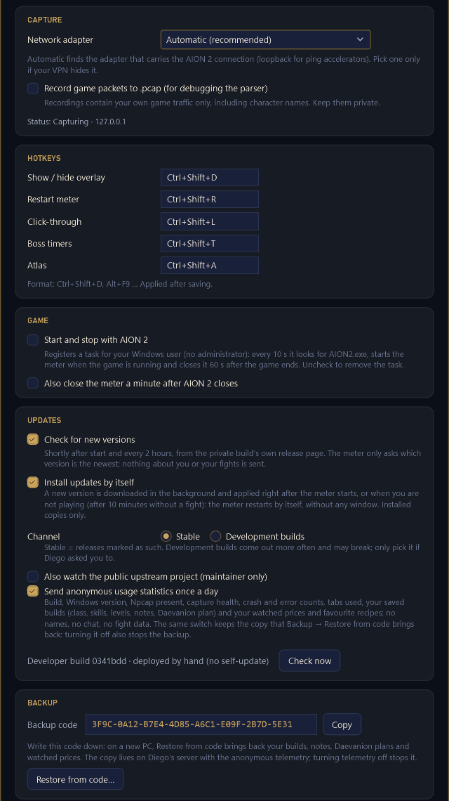
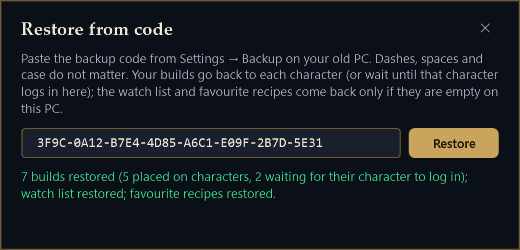

<h1 align="center">AION2 DPS Meter — build del clan</h1>

  Una build privada y auditada de <a href="https://github.com/cyberbadger6969/aion2-dps-meter">cyberbadger6969/aion2-dps-meter</a> para <b>AION 2 Global (EU)</b>. 
  DPS del grupo, vida del jefe, desglose de habilidades y temporizadores de jefes encima del juego — y además un mapa de nodos, rankings de DPS, avisos de precios del mercado, crafteo, builds y tus objetos en todos tus personajes.

  
  
  

<a href="README.md">English</a> · <b>🇪🇸 Español</b>

  

> Los grupos, combates, precios vigilados y rankings de estas imágenes son inventados por la herramienta de render del propio meter. Las imágenes de Build e Items usan un build público real de questlog.gg y los personajes del propio mantenedor.

La interfaz del meter está en inglés (o ruso), así que los nombres de botones y menús se citan en inglés, tal como aparecen. Las páginas de ayuda de cada pestaña sí están en español.

## Qué es

Este repositorio solo guarda los **zips de cada versión** y esta página. El meter es el AION2 DPS Meter de código abierto de **cyberbadger6969**, recompilado por Diego (akunito) para su clan a partir del código que ha leído línea a línea, con pestañas extra. Cada versión se compila desde ese código auditado en un contenedor limpio, todos los tests tienen que pasar antes de crear el zip, y cada zip lleva `BUILD-INFO.txt` (el commit exacto del código) y `SHA256SUMS.txt`.

La captura es **pasiva**, igual que en el original: el meter lee con Npcap el tráfico de red que el servidor del juego manda a tu PC. Nunca envía nada al juego, nunca lee ni escribe la memoria del juego, no inyecta nada y no necesita permisos de administrador. Aun así, cualquier herramienta externa puede ir contra las normas del juego: úsalo bajo tu responsabilidad.

Licencia: **GPL-3.0**, la misma que el original (`LICENSE` va en cada zip). El código de esta build está disponible pidiéndoselo al mantenedor.

## Descarga

**[⬇ Última versión](https://github.com/akunito/aion2-meter-releases/releases/latest)** — un solo archivo, `AION2DpsMeter-v<versión>-win-x64.zip` (unos 75 MB; 96 MB descomprimido). No hay instalador: descomprimir y ejecutar. .NET va incluido.

Dentro del zip, en una carpeta `AION2DpsMeter`: `AION2DpsMeter.exe`, la carpeta `data` que necesita a su lado, `INSTALL.txt`, la guía del clan (`LEEME - guia para el clan`), la lista completa de funciones (`FUNCIONALIDADES.md`), `LICENSE`, `BUILD-INFO.txt` y `SHA256SUMS.txt`.

Las **pre-releases** son el canal de desarrollo. No las uses salvo que Diego te pida probar una.

## Funciones

Del original (0.2.6):

- **Overlay en vivo** — DPS, daño y porcentaje de cada jugador y la vida del jefe, cinco veces por segundo. Colores y emblemas de clase, tu fila resaltada, puntuación de equipo (GS) y poder de combate (CP) tuyos y de tu grupo.
- **Aparece cuando peleas** y se esconde 60 s después; se puede fijar, hacer que los clics lo atraviesen y cambiar la opacidad. Nunca le quita el foco al juego.
- **Desglose completo** — clic en un jugador: línea temporal de DPS frente al grupo, cada habilidad con golpes, daño, DPS, media, golpe máximo, críticos y porcentaje; pestañas de precisión (crítico, espalda, frente, perfecto, smite) y de rotación (cada cast en orden); daño recibido.
- **Historial de combates** — los combates con jefe y los largos se guardan solos y se pueden recorrer en el propio overlay.
- **Temporizadores de jefes de campo sacados del juego** — abre una vez la lista de jefes de campo en el mapa del juego y el meter lleva la cuenta atrás de cada uno, por servidor, con aviso antes de que vuelva un jefe que vigilas.
- **Compartir en el chat** — una línea para el chat del juego o una tabla para Discord.
- **Jefes de mundo con multitud** — cuando el servidor deja de mandar el daño de casi todos, el meter lo dice ("133 attacking · damage of 3 sent") en vez de enseñar números falsos.

Añadido en esta build:

- **Pestañas dentro del overlay** — Meter · Atlas · Top DPS · Prices · Craft · Build · Items, y un botón para abrir cualquier pestaña en una segunda tarjeta (el mapa en un monitor y el medidor en otro).
- **Atlas** — mapas calibrados de Verteron, Altgard y el Abismo inferior contigo, los nodos de recolección vivos y recordados (unidades que quedan, reaparición aprendida), jefes de campo, las cinco mejores zonas de cada material y los puntos de las mascotas que aún no tienes al máximo.
- **Top DPS** — los diez mejores DPS por clase de tus propios combates con reparto por habilidad, apertura, secuencias repetidas y casts por minuto; los rankings de poder de combate del servidor y de Europa.
- **Prices** — vigila objetos en aion2.exchange: suena un aviso cuando el anuncio más barato baja a tu precio (o sube a tu precio de venta).
- **Craft** — lo que puedes fabricar ahora con tu bolsa y almacenes, lo que casi puedes (te faltan 1–2 materiales), favoritas, y una calculadora de beneficio contra el mercado.
- **Build** — tu build de habilidades con la maqueta del planificador de questlog.gg y un planificador de Daevanion, comparados con la ficha oficial de tu personaje; importar por enlace o búsqueda, tus propios builds de questlog, notas por habilidad y relaciones automáticas entre habilidades.
- **Items** — bolsa, almacén del personaje, almacén compartido de la cuenta y equipo puesto, con un buscador entre todos tus personajes.
- **Pastillas de eventos** — cuenta atrás de Shugo, Invasion, Rift, Kaira, Siege y Reset con aviso sonoro.
- **Selector de personaje** — mira los objetos, builds y crafteos de otro personaje, incluso mientras juegas.
- **Ayuda en cada pestaña** — el botón **?** abre una página de esa pestaña, en inglés o en español.
- **Se actualiza solo** desde este repositorio (canal estable o de desarrollo), **arranca con el juego** si quieres, **informes de fallos** a Diego en dos clics, un interruptor de **estadísticas anónimas** y un **código de copia de seguridad** que recupera tus builds en un PC nuevo.
- **Funciona sin Npcap** — todo menos el DPS en vivo sigue funcionando, y la captura arranca sola en cuanto instalas Npcap.

## Requisitos

- Windows 10 u 11 de 64 bits.
- AION 2 en servidores Global, EU (Steam o el launcher de NC). Esta build se hace y se prueba en EU.
- [Npcap](https://npcap.com/#download), el driver de captura gratuito que usa Wireshark (se instala una vez).
- Unos 100 MB de disco.

## Instalación

1. **Instala [Npcap](https://npcap.com/#download).** Descarga "Npcap 1.xx installer for Windows", ábrelo, acepta la licencia y deja todas las opciones como vienen (así también captura el tráfico que pasa por ExitLag y otros aceleradores de ping). Es el único paso que pide permiso de administrador. Sáltalo si ya tienes Npcap (por ejemplo, por Wireshark).
2. **Descomprime el meter en una carpeta tuya**, por ejemplo `Documentos\AION2DpsMeter`: clic derecho en el zip → *Extraer todo…*. `AION2DpsMeter.exe` y la carpeta `data` tienen que quedar juntos. No lo abras desde dentro del zip.
3. **Abre `AION2DpsMeter.exe`.** La primera vez Windows puede decir *"Windows protegió su PC"*: pulsa *Más información* → *Ejecutar de todas formas*. Sale porque la build no está firmada con un certificado de pago; solo pasa la primera vez.

### Primer arranque

- Aparece una **A** dorada en la zona de notificaciones, junto al reloj (pulsa la flechita **^** si está oculta). Pon el ratón encima: *"Waiting for the game to connect…"* es que el meter está listo y espera al juego; *"Capturing · …"* es que ya está leyendo el juego.
- El overlay sale unos segundos y luego se esconde hasta que pelees. <kbd>Ctrl</kbd>+<kbd>Shift</kbd>+<kbd>D</kbd> lo vuelve a mostrar.
- **Abre el meter antes de entrar con tu personaje**, y siempre antes de entrar en una mazmorra: los nombres de los jugadores llegan en las pantallas de carga, y tus mascotas, inventario y títulos al entrar. Los jugadores que ya estaban alrededor salen como `Templar #12345` hasta la siguiente pantalla de carga.
- El primer arranque avisa con un globo de las estadísticas anónimas (ver [Privacidad](#privacidad)).
- Para cerrar el meter: clic derecho en la **A** dorada → *Exit*. La X y <kbd>Ctrl</kbd>+<kbd>Shift</kbd>+<kbd>D</kbd> solo esconden la ventana.

Ajustes, combates, builds y todo lo demás se guardan en `%AppData%\AionMeter` y sobreviven a las actualizaciones.

## Cómo se usa

| | |
|---|---|
| <kbd>Ctrl</kbd>+<kbd>Shift</kbd>+<kbd>D</kbd> | mostrar / ocultar el overlay |
| <kbd>Ctrl</kbd>+<kbd>Shift</kbd>+<kbd>R</kbd> o ↻ | reiniciar el medidor si los números parecen raros: guarda el combate hasta ese momento y empieza de cero |
| <kbd>Ctrl</kbd>+<kbd>Shift</kbd>+<kbd>L</kbd> | clic a través: los clics van al juego (otra vez para quitarlo) |
| <kbd>Ctrl</kbd>+<kbd>Shift</kbd>+<kbd>T</kbd> | temporizadores de jefes de campo |
| <kbd>Ctrl</kbd>+<kbd>Shift</kbd>+<kbd>A</kbd> | pestaña Atlas / volver al medidor |
| clic izquierdo en un jugador | abrir el desglose |
| clic derecho en un jugador, o 💬 | copiar el resultado para el chat del juego o Discord; pegar con <kbd>Ctrl</kbd>+<kbd>V</kbd> |
| rueda del ratón sobre el título del combate | pasar de un combate a otro (abajo = más antiguo, arriba del todo = en vivo) |
| <kbd>Ctrl</kbd> + rueda sobre las filas | tamaño de fila, 50–100 % |
| pulsar otra vez la pestaña activa | volver al medidor |
| clic derecho en una pastilla de evento o de jefe | activar o quitar sonido y notificación de Windows |
| **A** dorada de la zona de notificaciones | historial, temporizadores, ajustes, informar de un problema, actualizaciones, salir |

Las teclas se cambian en *Settings → Hotkeys*. La barra de botones (candado, opacidad, ajustes, chat, reinicio, ocultar) aparece al poner el ratón sobre el overlay. Mientras hay abierta una pestaña que no es el medidor, el clic a través se desactiva y el overlay no se esconde solo.

## Las pestañas

Los iconos de arriba a la izquierda del overlay cambian de pestaña (pon el ratón encima para ver su nombre). La flecha de al lado abre la pestaña actual en una segunda tarjeta con su propia X. El botón **?** abre la página de ayuda de la pestaña en la que estás.

### Meter

El medidor de daño: una fila por jugador con puesto, nombre, clase, GS y CP, DPS, daño total y porcentaje; la barra de vida del jefe arriba; *TOP HIT*; abajo el estado de la captura, *Open the fight* y *Fights*; y debajo la pastilla del jefe y las de eventos.

<table>
  <tr>
    <td width="50%"> <b>Desglose</b> — línea temporal de DPS y cada habilidad del jugador</td>
    <td width="50%"> <b>Precisión</b> — crítico, espalda, frente, perfecto y smite por habilidad</td>
  </tr>
  <tr>
    <td width="50%"> <b>Rotación</b> — cada cast en orden, los críticos con anillo dorado</td>
    <td width="50%"> <b>Temporizadores</b> — leídos del mapa del juego, al segundo</td>
  </tr>
</table>

- **Temporizadores de jefes de campo**: en el juego abre una vez *Mapa → Exploración → Monstruos de campo*; el meter copia la lista y lleva la cuenta atrás de cada jefe, por servidor. La campana de un jefe suena 2 minutos antes de que vuelva. Se abren con <kbd>Ctrl</kbd>+<kbd>Shift</kbd>+<kbd>T</kbd> o con la pastilla dorada.
- **Pastillas de eventos**: Shugo (cada hora a las :03, unos 3 minutos), Invasion (:30), Rift (cada 3 h desde las 02:00), Kaira (cada 3 h desde la 01:00), Siege (lunes, jueves y sábado a las 21:00) y el Reset diario, en hora del servidor. Se ponen naranjas y rojas al acercarse y suenan 10 y 5 minutos antes. Las notificaciones de Windows vienen apagadas porque un aviso encima del juego baja los FPS; clic derecho en una pastilla para cambiar sonido o notificación.
- El juego no avisa de cuándo empieza el Shugo, así que su hora es aproximada: si ves que empieza en otro minuto, clic derecho en su pastilla → *Starts now* y el meter recoloca el ciclo.

### Atlas

- Mapas calibrados de **Verteron, Altgard y el Abismo inferior**. Tú eres el punto dorado (el servidor no manda tu movimiento al caminar, así que se mueve cuando usas habilidades o recolectas). En otras zonas no hay mapa, pero los nodos se siguen apuntando.
- **Nodos** con su icono: verde con número = a la vista y las unidades que quedan; *N?* = vivo la última vez que lo viste; gris con un tiempo = agotado y vuelve en ese tiempo, cuando el meter ya ha aprendido la reaparición de ese punto; tenue = conocido por los datos del mapa pero aún no visto por ti. Las calaveras son jefes de campo (rojo vivo, gris con la cuenta atrás).
- Los botones de materiales de la cabecera marcan las **cinco mejores zonas** de ese material (hasta dos a la vez). La capa **Pets** marca los monstruos que sueltan almas de las mascotas que tienes por debajo de nivel 3: rojo = no la tienes, naranja = nivel 1, amarillo = nivel 2. Clic derecho en un punto de mascota para ver una tarjeta con el monstruo, tu nivel de esa mascota, las almas por nivel y los otros monstruos que la sueltan.
- Arrastra para moverte, rueda para el zoom, *Follow me* para que el mapa te siga, *Fit* para ver la zona entera. Clic derecho en un nodo desconocido para decir qué es.

### Top DPS

- **My fights**: los diez mejores DPS por clase que este meter ha visto en tus combates (un combate por jugador, de 30 s o más). Clic en una fila para ver el reparto por habilidad, la apertura (primeros 16 casts), las secuencias de 3 casts más repetidas y los casts por minuto; *Open* abre el combate guardado.
- **Server** y **Europe**: los diez personajes más fuertes de cada clase por poder de combate, del ranking público de aion2index.com (el juego no publica ranking de DPS).
- *Load profile* enseña la ficha oficial de ese personaje (equipo, habilidades, Daevanion) para compararla con la tuya.

### Prices

- Busca un objeto por su nombre en **inglés o español**, escribe un precio máximo (`850k`, `1.2m`, `1,200,000`) y pulsa *Add*. Marca *sell above* (o pulsa **≤ / ≥** en una fila) para que te avise cuando algo que tienes suba por encima de un precio.
- Una vez por hora el meter mira el anuncio más barato en **aion2.exchange**; cuando llega a tu precio suena un aviso y la fila se pone verde. Si no vigilas nada, no consulta nada.
- Cada fila enseña el último precio, su tendencia en 24 h, el número de anuncios y — si rellenas *units* y *paid each* — lo que vale lo que tienes y cuánto ganas.
- *Copy market script* copia un script para la consola del navegador en aion2.exchange que exporta todo el mercado de tu servidor a un archivo: es lo que usa la calculadora de beneficio de Craft.

### Craft

<table>
  <tr>
    <td width="50%"> <b>Craft</b> — lo que puedes fabricar ahora (×N), favoritas primero</td>
    <td width="50%"> <b>Profit</b> — margen de cada receta contra la exportación del mercado</td>
  </tr>
</table>

- Las recetas que puedes fabricar **ahora** con tu bolsa y los dos almacenes, y con *×N* cuántas veces. *Also short by 1–2 materials* añade las que casi puedes hacer, con lo que falta y de dónde sale (recolección, crafteo, drop de mazmorra con su probabilidad, NPC, logro).
- El buscador mira en todas las recetas, en inglés o español; la **estrella** fija una receta arriba de todas las listas.
- **Beneficio**: *Load market file…* con la exportación de Prices, marca *Profit* y salen todas las recetas cuyo resultado se vende, por margen (anuncio más barato × cantidad tras la comisión, menos los materiales más baratos). Un margen alto con uno o dos anuncios puede no venderse.

### Build

<table>
  <tr>
    <td width="50%"> <b>Skills &amp; Stigmas</b> — nivel objetivo abajo a la derecha, el tuyo abajo a la izquierda</td>
    <td width="50%"> <b>Daevanion</b> — el plan frente a los nodos que tienes abiertos, con las estadísticas sumadas</td>
  </tr>
  <tr>
    <td colspan="2"> <b>Import</b> — pega un enlace de questlog.gg, busca builds públicos o lista los tuyos</td>
  </tr>
</table>

- El build de habilidades de tu personaje con la **maqueta del planificador de questlog.gg**, comparado con su ficha oficial: en cada icono el número de abajo a la derecha es el nivel que pide el build y el de abajo a la izquierda el tuyo — verde ya llegas, ámbar te faltan 4 niveles o menos, rojo te falta más o no la has aprendido. Desmarca *Show skills already at the build level* para ver solo lo pendiente.
- Si aún no tienes build, la pestaña te ofrece los cinco builds públicos de tu clase con más "me gusta": *Add* para empezar con uno, *Search…* para buscar otro, *Import…* para el enlace de questlog que te pase un compañero, o *New from profile* para partir de lo que tienes. Sin iniciar sesión, *Import… → My builds* lista tus propios builds y planes de questlog, y *Check questlog* ofrece *Update* cuando tu copia en questlog es más nueva.
- **Daevanion**: los cinco tableros de tu clase; clic en los nodos para planear, ver cuáles ya tienes abiertos y comparar las estadísticas del plan con las de ahora. *Import plan…* carga un plan del daevanion-planner de questlog.
- Clic en una habilidad para ver su barra de nivel, sus especializaciones, tu nota (*When to use · combos*) y las **relaciones** que el meter saca solo (qué buff le da otra habilidad, qué estado necesita y quién lo pone, la cadena de su tecla, su puesto en tu prioridad). Todo se guarda en tu PC, un archivo por build; *Copy for questlog* lo publica desde tu propia sesión del navegador.

### Items

- La **bolsa** y el **almacén del personaje** con el que juegas, el **almacén compartido de la cuenta** (el "almacén del servidor" del juego, juntado hueco a hueco con lo que vio cada personaje; un punto azul marca los huecos que otro personaje cambió después) y el **equipo puesto**. Color del marco = grado; vista de casillas o lista, filtros y orden.
- **Buscador entre personajes** (inglés o español): las casillas que coinciden se iluminan y el panel lateral dice dónde está cada objeto en cada personaje, de dónde sale y qué recetas lo usan, con *Open in Craft →*.
- El pie suma por personaje Kina, Kina ligada, Puntos del Abismo, Piedras de encantamiento y el valor de lo que tiene. El juego solo manda un almacén al abrir su ventana: abre cada uno una vez con el meter encendido.

### Selector de personaje

El desplegable junto a las pestañas elige de quién son la bolsa, los almacenes, los builds y las cuentas de Craft que enseñan las pestañas. Funciona mientras juegas: el personaje conectado sale como *(current)* y sigue recibiendo los datos en vivo, y la caja se pone ámbar mientras miras a otro. Si entras con otro personaje en el juego, la vista cambia a él.

## Ajustes que conviene conocer

Captura de una build de desarrollo; una versión publicada enseña su número encima de <i>Check now</i>.

- **Capture → Network adapter**: *Automatic* encuentra el adaptador que lleva la conexión del juego (incluido el loopback de ExitLag). Elige uno a mano solo si una VPN lo oculta.
- **Hotkeys**: todas se pueden cambiar, se aplican al guardar.
- **Game → Start and stop with AION 2**: crea una tarea para tu usuario de Windows (sin administrador) que arranca el meter cuando el juego está abierto y lo cierra un minuto después de cerrar el juego. Desmárcala para quitar la tarea.
- **Updates**: el meter mira este repositorio poco después de arrancar y cada 2 horas. *Install updates by itself* descarga el zip nuevo en segundo plano, comprueba su tamaño y su SHA-256 con GitHub y lo aplica al siguiente arranque o cuando no estás jugando (tras 10 minutos sin combate); el meter se reinicia solo y tus ajustes se quedan. Desmárcalo para que te pregunte. **Channel**: *Stable* (por defecto) o *Development builds* — deja Stable salvo que Diego te pida otra cosa.
- **Overlay**: barras relativas al primero o al total del grupo, barra de vida del jefe, GS / CP, mostrarse solo y ocultarse tras N segundos, filas, opacidad, tamaño de fila.
- **Language**: la interfaz está en inglés o ruso (los idiomas del original). Las páginas de ayuda tienen su propio selector English / Español.

## Código de copia de seguridad

*Settings → Backup* enseña tu código (8 grupos de 4) con un botón *Copy*: apúntalo. En un PC nuevo pulsa *Restore from code…* y pégalo: tus builds (habilidades, notas, planes de Daevanion) vuelven a sus personajes — un personaje que aún no ha entrado en el PC nuevo los recibe la primera vez que entre — y, si allí están vacíos, tus precios vigilados y recetas favoritas. La restauración nunca es automática, un build que cambiaste después de la copia se conserva, y la copia solo existe mientras las estadísticas anónimas estén activadas.

## Informar de un problema

Clic derecho en la **A** dorada → *Report a problem…*, cuenta qué pasó y pulsa *Send to Diego*: le llega al móvil. El zip lleva los dos últimos registros, los ficheros de cierres inesperados, tus ajustes (sin direcciones privadas), el resumen de estado, tu lista de Top DPS y la información de la build; tu inventario, títulos y mascotas solo si marcas la casilla. *Save zip only* lo guarda en tu PC para pasarlo por Discord. Si el meter da un error, un globo abre esa misma ventana. Se pueden mandar como mucho 2 informes por minuto, 5 por hora y 10 al día.

## Privacidad

El meter lee el tráfico del juego en tu PC y lo guarda todo en `%AppData%\AionMeter`. Nunca ve tu cuenta ni tu contraseña y nunca manda tus combates a ningún sitio.

Lo que consulta (solo lectura):

- **aion2.plaync.com** — la ficha oficial pública de tu personaje (habilidades, Daevanion, equipo) al entrar y cada 6 horas; las fichas que abras en Top DPS.
- **questlog.gg** — builds públicos para la pestaña Build (sugerencias, búsqueda, importaciones, tus propios builds).
- **aion2.exchange** — una vez por hora, solo los objetos que vigilas en Prices.
- **aion2index.com** — los rankings Server / Europe, solo si los abres.
- **aion2hub.me** — iconos de objetos y nombres que no vienen incluidos, cuando hacen falta.
- **assets.playnccdn.com** y **metabot.gg** — iconos de habilidades y retratos de jefes, una vez cada uno (se puede apagar en Settings).
- **github.com** — la comprobación de versión y la descarga de la actualización desde este repositorio.

Lo que envía:

- **Estadísticas de uso anónimas**, una vez al día: la versión, la de Windows, si hay Npcap, la salud de la captura, cuántos cierres inesperados y errores hubo y qué pestañas usaste; cada build que guardas (clase, habilidades, niveles, prioridad, macros, plan de Daevanion y notas) como mucho una vez al día por build; tu lista de precios vigilados y tus recetas favoritas, como mucho unas pocas veces al día. Nunca nombres de personaje, chat ni datos de combate: cada build va marcado con un hash de tu personaje, no con su nombre. Esta copia es la que recupera *Restore from code*. Se apaga en *Settings → Updates → Send anonymous usage statistics* (lo que también apaga la copia de seguridad). El primer arranque te lo avisa con un globo.
- **Informes de fallos**, solo cuando pulsas *Send to Diego*; van al mantenedor y a nadie más.

Las grabaciones de paquetes (*Settings → Capture → Record game packets*, apagado por defecto) contienen tu tráfico del juego, incluidos nombres de personajes: no las publiques.

## Preguntas frecuentes

**El overlay está vacío / no veo DPS.**
Comprueba que Npcap está instalado (paso 1) — sin él funciona todo menos el DPS en vivo, y la línea de estado lo dice; en cuanto lo instalas, la captura arranca sola. Pon el ratón sobre la **A** dorada: si dice *"No Npcap adapter carries the game connection"*, elige tu adaptador en *Settings → Capture*. El overlay se esconde fuera de combate: <kbd>Ctrl</kbd>+<kbd>Shift</kbd>+<kbd>D</kbd> lo enseña. La pantalla completa exclusiva lo tapa: juega en ventana sin bordes o pon el meter en otro monitor.

**Los jugadores salen como "Templar #12345".**
Los nombres llegan en las pantallas de carga. Entra en una mazmorra o pasa una pantalla de carga y aparecen; la próxima vez abre el meter antes de entrar con el personaje.

**¿Funciona con ExitLag o con VPN?**
Sí con ExitLag y otros aceleradores de ping (las opciones por defecto de Npcap capturan su loopback). Si una VPN oculta la conexión del juego, elige el adaptador en *Settings → Capture*.

**Faltan iconos de objetos.**
El zip no trae imágenes de objetos (hay más de 12.000): cada icono se descarga la primera vez que una fila lo necesita y se guarda, así que van apareciendo en unos segundos. Algunos iconos son WebP y solo se ven si Windows tiene el códec WebP. Los iconos de habilidades y los retratos de jefes funcionan igual, y *Settings → Download skill icons and boss portraits* lo apaga todo.

**¿Cómo traigo un build de questlog.gg?**
Pestaña Build → *Import…* → pega el enlace (`…/skill-builder/<usuario>?build-id=<n>`, o un enlace de `daevanion-planner` para un plan) → *Import*. O busca entre los builds públicos, o abre *My builds* para ver tus propios builds de questlog sin iniciar sesión. Importar otra vez el mismo build lo actualiza y conserva tus notas y tu plan.

**Tengo un PC nuevo. ¿Cómo recupero mis builds?**
Instala el meter y ve a *Settings → Backup → Restore from code…* y pega el código que apuntaste. Solo funciona si en el PC viejo las estadísticas anónimas estaban activadas.

**Windows o el antivirus se quejan.**
La build no está firmada con un certificado de pago y lee el tráfico de red, cosa que a algunos antivirus no les gusta. Permítelo (Seguridad de Windows → Protección contra virus y amenazas → Historial de protección → Permitir) o excluye la carpeta del meter; si dudas, pregunta a Diego. Puedes comprobar el zip con `SHA256SUMS.txt`.

**Me sale un aviso de versión nueva.**
Es normal: el meter se actualiza solo desde este repositorio y se reinicia por su cuenta; tus ajustes e historial se quedan.

**Mi porcentaje de críticos en un jefe de campo lleno de gente es casi cero / en un jefe de mundo faltan casi todos.**
En jefes con mucha gente el juego deja de mandar a tu cliente casi todo el daño (y muchos críticos). El meter enseña exactamente lo que llega y dice *"N attacking · damage of M sent"* en vez de un DPS de grupo que no puede saber.

**¿Me pueden banear?**
El meter no toca el juego: no lee memoria, no inyecta nada, no le envía nada. Aun así, las herramientas externas pueden ir contra las normas — tú decides.

## Créditos y licencia

- **[cyberbadger6969/aion2-dps-meter](https://github.com/cyberbadger6969/aion2-dps-meter)** — el meter en el que se basa esta build: captura, protocolo, motor de combate, overlay, desglose, historial y temporizadores de jefes. GPL-3.0. Sus tablas de datos del juego vienen de los proyectos GPL-3.0 [A2Tools-DPS-Meter](https://github.com/taengu/A2Tools-DPS-Meter) (taengu) y [AIon2-Dps-Meter](https://github.com/Kuroukihime/AIon2-Dps-Meter) (Kuroukihime).
- **[questlog.gg](https://questlog.gg)** — la base de datos de habilidades y los builds y planes públicos que la pestaña Build lee e importa.
- **[aion2hub.me](https://aion2hub.me)** — nombres de objetos, recetas, fuentes de objetos, mascotas y títulos, y los iconos de objetos.
- **[aion2.exchange](https://aion2.exchange)** — los precios del mercado para Prices y la calculadora de beneficio de Craft.
- **[shugo.gg](https://shugo.gg)** — los horarios de los eventos y las teselas del mapa y las posiciones de nodos del Atlas.
- **[aion2index.com](https://aion2index.com)** — los rankings de poder de combate de Top DPS.
- Iconos de habilidades del CDN oficial de AION 2, fichas de personaje de la web oficial de AION 2, retratos de jefes de [MetaBot.GG](https://metabot.gg).

Esta build se distribuye bajo la **GPL-3.0**, la licencia del original; el texto completo es `LICENSE` en cada zip. AION 2 y sus datos y arte son © NCSOFT; este proyecto no está afiliado a NCSOFT ni al autor del original.
