<h1 align="center">AION2 DPS Meter — akunito's fork</h1>

<p align="center">
  An open-source DPS meter for <b>AION 2 Global (EU)</b>, on Windows and Linux.<br>
  Party DPS, boss HP, skill breakdown and boss timers on top of the game — plus a node map, DPS rankings, market price alerts, crafting, builds and your items across characters.
</p>

<p align="center">
  <a href="https://github.com/akunito/aion2-meter-releases/releases/latest"></a>
  
  
  <a href="LICENSE"></a>
</p>

<p align="center"><b>English</b> · <a href="README.es.md">🇪🇸 Versión en español</a></p>

> **Built on [cyberbadger6969/aion2-dps-meter](https://github.com/cyberbadger6969/aion2-dps-meter).** This is a fork, and the core is theirs: the capture, the protocol decoding, the combat engine, the overlay, the breakdown, the fight history and the boss timers are cyberbadger6969's work, and this fork does not rewrite them — it follows upstream releases and adds its tabs and the Linux version on top. Upstream's game data tables come from [taengu/A2Tools-DPS-Meter](https://github.com/taengu/A2Tools-DPS-Meter) and [Kuroukihime/AIon2-Dps-Meter](https://github.com/Kuroukihime/AIon2-Dps-Meter). If the meter is useful to you, star and support [the original project](https://github.com/cyberbadger6969/aion2-dps-meter) too.

<p align="center">
  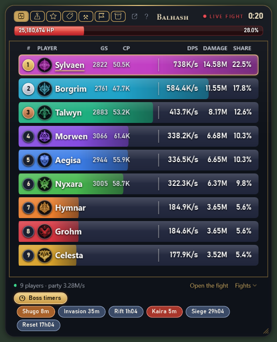
</p>

> Every party, fight, price watch and ranking in these pictures is made up by the meter's own render tool. The Build and Items pictures use a real public questlog.gg build and the maintainer's own characters.

## What this is

This repository holds the **source code** of the fork and its **releases**. The maintainer (akunito) started it as an audited build for his clan — upstream's source read commit by commit, with extra tabs on top — and opened it once the Linux version was ready. Every release is compiled from this source in a clean container (`build/build.sh`), the whole test suite has to pass before an archive is made, and each archive carries `BUILD-INFO.txt` (the exact source commit) and `SHA256SUMS.txt`.

The capture is **passive**, exactly as upstream: the meter reads the network traffic the game server sends to your PC (Npcap on Windows, libpcap on Linux). It never sends anything to the game, never reads or writes the game's memory and injects nothing. Any third-party tool may still be against the game's terms of service: use it at your own risk.

Licence: **GPL-3.0**, the same as upstream (`LICENSE` is in the repository and in every archive).

## Download

**[⬇ Latest release](https://github.com/akunito/aion2-meter-releases/releases/latest)** — two files per release:

- **Windows**: `AION2DpsMeter-v<version>-win-x64.zip` (about 75 MB). No installer: unzip and run. .NET is built in. Inside, in a folder `AION2DpsMeter`: `AION2DpsMeter.exe`, the `data` folder it needs next to it, `INSTALL.txt`, `LICENSE`, `BUILD-INFO.txt` and `SHA256SUMS.txt`.
- **Linux**: `AION2DpsMeter-v<version>-linux-x64.tar.gz`. The capture daemon, the GTK 4 card and an `install.sh`; see [Linux](#linux).

**Pre-releases** are the development channel. Leave them alone unless you want to test one.

## Features

From upstream:

- **Live overlay** — party DPS, damage and share for every player and the boss's HP, five times a second. Class colours and emblems, your row highlighted, gear score and combat power for you and your party.
- **Shows up when you fight** and hides 60 s after; lock it, make it click-through, set the opacity. It never takes focus from the game.
- **Full breakdown** — click a player: DPS timeline against the party, every skill with hits, damage, DPS, average and biggest hit, crit rate and share; accuracy (crit, back, front, perfect, smite) and rotation (every cast in order) tabs; damage taken.
- **Fight history** — boss fights and longer fights saved automatically, scrollable right in the overlay.
- **Field boss timers from the game** — open the field boss list on the in-game map once and the meter keeps every respawn counting down, per server, with an alert before a boss you watch returns.
- **Instance and boss time limit** in the header (⏱ 46:52), red in the last minute.
- **Share in chat** — one line for the game chat or a table for Discord.
- **Crowded world bosses** — when the server stops sending most players' damage, the meter says so ("133 attacking · damage of 3 sent") instead of showing wrong numbers.

Added in this fork:

- **Tabs inside the overlay** — Meter · Atlas · Top DPS · Prices · Craft · Build · Items · Boss Timers · Settings, and a pop-out button to open any tab in a second card (the map on one monitor, the meter on the other).
- **Interface in English or Spanish** — the EN/ES chip on the overlay or *Settings → Language*; the names of items, skills and monsters can follow it or have their own language.
- **Player card** — the fight breakdown and Top DPS open one card per player: the fight, plus the official profile (gear, skills, Daevanion).
- **Atlas** — calibrated maps of Verteron, Altgard and the Lower Abyss with you, live and remembered gathering nodes (units left, learned respawn), field bosses, the five best areas per material and the spawns of the pets you have not maxed.
- **Top DPS** — the ten best DPS per class from your own fights with skill shares, opener, repeated sequences and casts per minute; the server and Europe combat-power rankings.
- **Prices** — watch items on aion2.exchange: a chime when the cheapest listing drops to your price (or rises to your sell price), with 24 h / 7 d / 30 d charts.
- **Craft** — what you can craft now from your bag and warehouses, what you are one or two materials short of, favourites, and a profit calculator against the market.
- **Build** — your skill build in questlog.gg's planner layout and a Daevanion planner, checked against your character's official profile; import by link or search, your own questlog builds, notes per skill and automatic skill relations.
- **Items** — bag, character warehouse, the account's shared warehouse and the equipped set, with a search across all your characters.
- **Event pills** — Shugo, Invasion, Rift, Kaira, Siege and Reset countdowns with sound alerts.
- **Character selector** — look at another character's items, builds and crafts, even while you play.
- **Region and server** — *Settings → Game* (Auto from the login); prices, rankings, profiles and timers follow the chosen server.
- **Help in every tab** — the **?** button opens a page for that tab, in English or Spanish.
- **Updates itself** from this repository on Windows (stable or development channel) and **starts with the game** if you want.
- **Works without Npcap** — everything but the live DPS keeps working, and the capture starts by itself once Npcap is installed.
- **Receive from another meter** — a meter that sees the game can forward its packets to a meter on another PC, in a VM or under Wine (*Settings → Capture*).
- **Linux version** — a capture daemon and a native GTK 4 card with every tab; see [Linux](#linux).

## Requirements

- Windows 10 or 11, 64-bit — or Linux x86_64 on Wayland (see [Linux](#linux)).
- AION 2 on the Global servers, EU (Steam or the NC launcher). This fork is made and tested on EU.
- Windows: [Npcap](https://npcap.com/#download), the free capture driver Wireshark uses (installed once).
- About 100 MB of disk space.

## Installation (Windows)

1. **Install [Npcap](https://npcap.com/#download).** Download "Npcap 1.xx installer for Windows", run it, accept the licence and keep every default option (they also capture traffic relayed by ExitLag and other ping boosters). This is the only step that asks for administrator rights. Skip it if you already have Npcap (for example from Wireshark).
2. **Unzip the meter into a folder of your own**, for example `Documents\AION2DpsMeter`: right-click the zip → *Extract all…*. `AION2DpsMeter.exe` and the `data` folder must stay together. Do not run it from inside the zip.
3. **Run `AION2DpsMeter.exe`.** The first time, Windows may say *"Windows protected your PC"*: click *More info* → *Run anyway*. It shows up because the build is not signed with a paid certificate; it only happens once.

### First start

- A gold **A** appears in the notification area next to the clock (click the **^** arrow if it is hidden). Hover it: *"Waiting for the game to connect…"* means the meter is ready and waiting; *"Capturing · …"* means it is reading the game.
- The overlay shows for a few seconds and then hides until you fight. <kbd>Ctrl</kbd>+<kbd>Shift</kbd>+<kbd>D</kbd> brings it back.
- **Start the meter before you log in with your character**, and always before entering a dungeon: player names arrive on loading screens, and your pets, inventory and titles arrive at login. Players who were already around show as `Templar #12345` until the next loading screen.
- To close the meter: right-click the gold **A** → *Exit*. The X and <kbd>Ctrl</kbd>+<kbd>Shift</kbd>+<kbd>D</kbd> only hide the window.

Settings, fights, builds and everything else live in `%AppData%\AionMeter` and survive updates.

## Using the meter

| | |
|---|---|
| <kbd>Ctrl</kbd>+<kbd>Shift</kbd>+<kbd>D</kbd> | show / hide the overlay |
| <kbd>Ctrl</kbd>+<kbd>Shift</kbd>+<kbd>R</kbd> or ↻ | restart the meter when the numbers look wrong: the fight so far is saved, counting starts over |
| <kbd>Ctrl</kbd>+<kbd>Shift</kbd>+<kbd>L</kbd> | click-through: clicks go to the game (press again to undo) |
| <kbd>Ctrl</kbd>+<kbd>Shift</kbd>+<kbd>T</kbd> | field boss timers |
| <kbd>Ctrl</kbd>+<kbd>Shift</kbd>+<kbd>A</kbd> | Atlas tab / back to the meter |
| left-click a player | open the breakdown |
| right-click a player, or 💬 | copy the result for the game chat or Discord; paste with <kbd>Ctrl</kbd>+<kbd>V</kbd> |
| mouse wheel over the fight title | scroll through fights (down = older, top = live) |
| <kbd>Ctrl</kbd> + mouse wheel over the rows | row size, 50–100 % |
| click the active tab again | back to the meter |
| right-click an event or boss pill | sound and Windows notification switches |
| gold **A** in the notification area | history, timers, settings, report a problem, updates, exit |

Hotkeys can be changed in *Settings → Hotkeys*. The toolbar (lock, opacity, settings, chat, restart, hide) appears when the mouse is over the overlay. While a tab other than the meter is open, click-through is off and the overlay does not hide by itself. On Linux the hotkeys are your compositor's key bindings: see [Commands](#commands).

## The tabs

The icons at the top left of the overlay switch tabs (hover them for their names). The pop-out arrow next to them opens the current tab in a second card with its own X. The **?** button opens the help page of the tab you are on.

### Meter

The damage meter: one row per player with place, name, class, GS and CP, DPS, total damage and share; the boss's HP bar on top; *TOP HIT*; the capture state, *Open the fight* and *Fights* at the bottom; the boss timer pill and the event pills below.

<table>
  <tr>
    <td width="50%">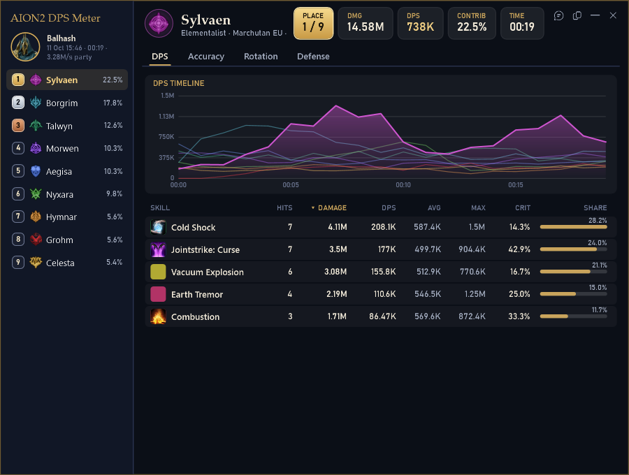<br><sub><b>Breakdown</b> — DPS timeline and every skill of the player</sub></td>
    <td width="50%">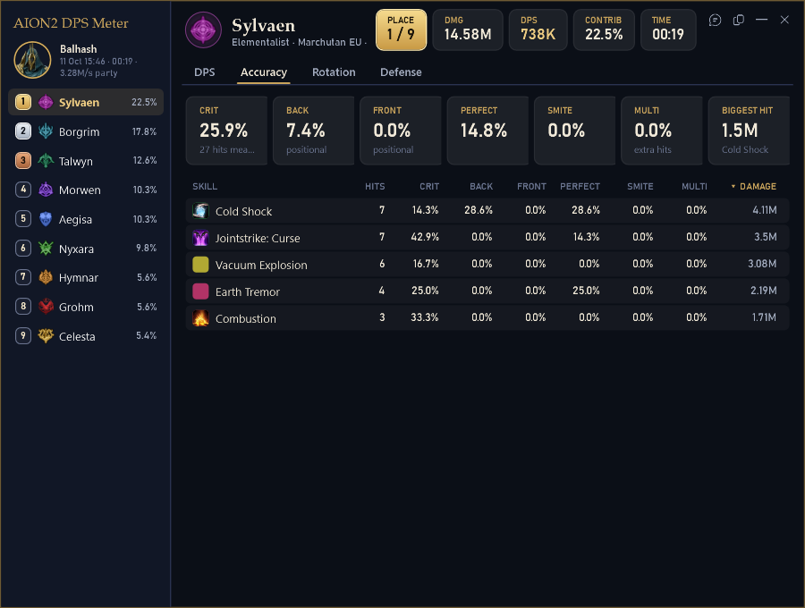<br><sub><b>Accuracy</b> — crit, back, front, perfect and smite per skill</sub></td>
  </tr>
  <tr>
    <td width="50%">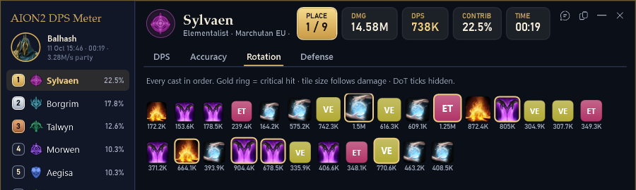<br><sub><b>Rotation</b> — every cast in order, crits ringed in gold</sub></td>
    <td width="50%">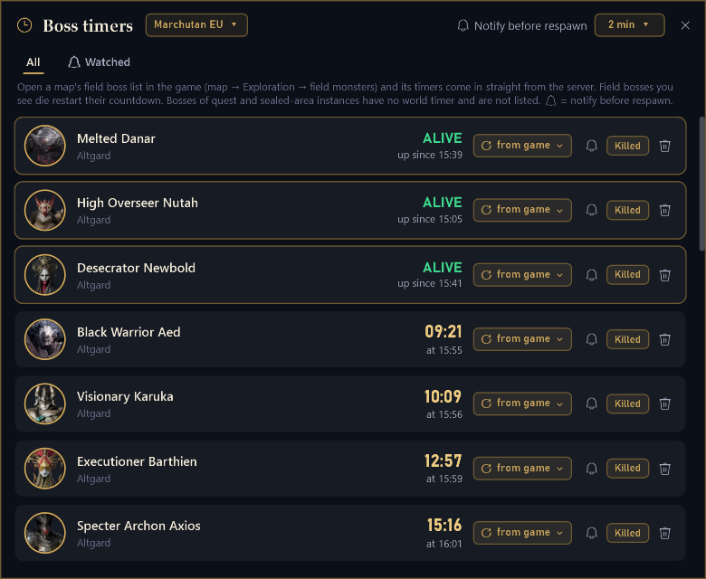<br><sub><b>Boss timers</b> — read from the in-game map, counted down to the second</sub></td>
  </tr>
</table>

- **Field boss timers**: in the game open *Map → Exploration → Field monsters* once; the meter copies the list and counts every respawn down, per server. The bell on a boss plays an alert 2 minutes before it returns. Open them with <kbd>Ctrl</kbd>+<kbd>Shift</kbd>+<kbd>T</kbd>, the gold pill or the Boss Timers tab.
- **Event pills**: Shugo (every hour at :03, about 3 minutes), Invasion (:30), Rift (every 3 h from 02:00), Kaira (every 3 h from 01:00), Siege (Monday, Thursday and Saturday 21:00) and the daily Reset, in server time. They turn orange and red as the start nears and play a sound 10 and 5 minutes before. Windows notifications are off by default because a toast over the game costs FPS; right-click a pill to switch sound or notification.
- The game never announces when Shugo starts, so its time is an estimate: if you see it begin at another minute, right-click its pill → *Starts now* and the meter re-phases the cycle.

### Atlas

<p align="center">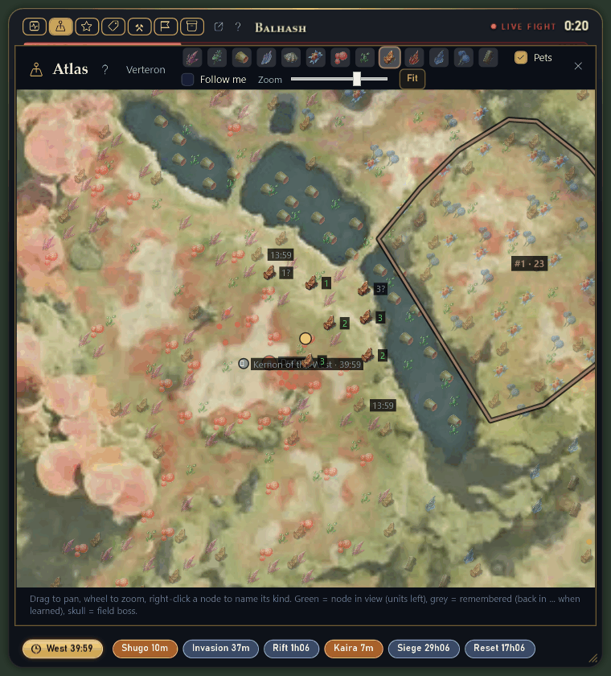</p>

- Calibrated maps of **Verteron, Altgard and the Lower Abyss**. You are the gold dot (the server does not send your walking, so it moves when you use skills or gather). In other zones there is no map, but nodes are still recorded.
- **Nodes** with their icon: green with a number = in view and the units left; *N?* = alive when you last saw it; grey with a time = emptied and back in that time, once the meter has learned that spot's respawn; faint = known from the map data but not seen by you yet. Skulls are field bosses (red alive, grey with the countdown).
- The material buttons in the header outline the **five best areas** for that material (up to two at once). The **Pets** layer marks the monsters that drop souls of pets you have below level 3: red = not owned, orange = level 1, yellow = level 2. Right-click a pet marker for a card with the monster, your pet level, souls per level and the other monsters that drop it.
- Drag to pan, wheel to zoom, *Follow me* to keep the map on you, *Fit* for the whole zone. Right-click an unknown node to name its kind, or mark it *Other (not a node)* to hide it for good.

### Top DPS

<p align="center">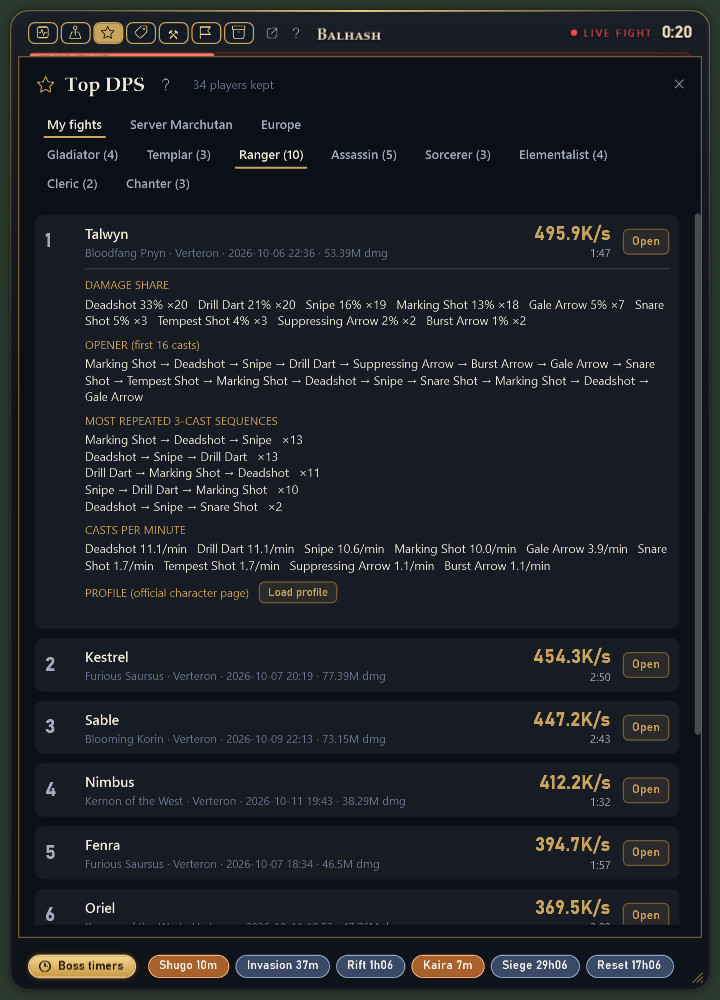</p>

- **My fights**: the ten best DPS per class this meter has seen in your fights (one fight per player, 30 s or longer). Click a row for skill shares, the opener (first 16 casts), the most repeated 3-cast sequences and casts per minute; *Open* shows the saved fight.
- **Server** and **Europe**: the ten strongest characters of each class by combat power, read from the public ranking at aion2index.com (the game publishes no DPS ranking).
- *Load profile* shows that character's official page (gear, skills, Daevanion) to compare with yours.

### Prices

<p align="center">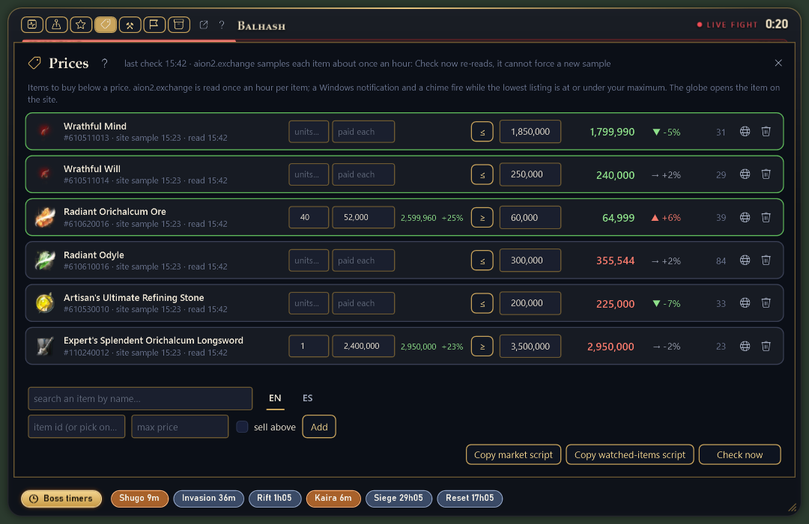</p>

- Search an item by name in **English or Spanish**, type a maximum price (`850k`, `1.2m`, `1,200,000`) and press *Add*. Tick *sell above* (or press **≤ / ≥** on a row) to be told when something you hold rises above a price.
- Once an hour the meter reads the cheapest listing on **aion2.exchange**; when it reaches your price you hear a chime and the row turns green. If you watch nothing, nothing is read.
- Each row shows the last price, its 24 h trend, the number of listings, and — if you fill *units* and *paid each* — the value of your stock and your gain. Expand a row for its price chart.
- *Copy market script* copies a script for your browser's console on aion2.exchange that exports your server's whole market to a file: it feeds the Craft profit calculator.

### Craft

<table>
  <tr>
    <td width="50%">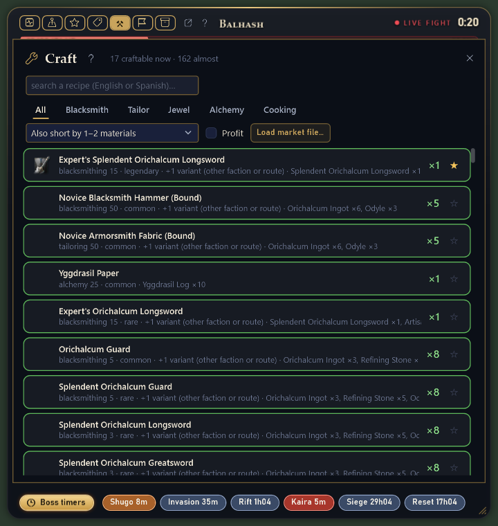<br><sub><b>Craft</b> — what you can craft now (×N), favourites first</sub></td>
    <td width="50%">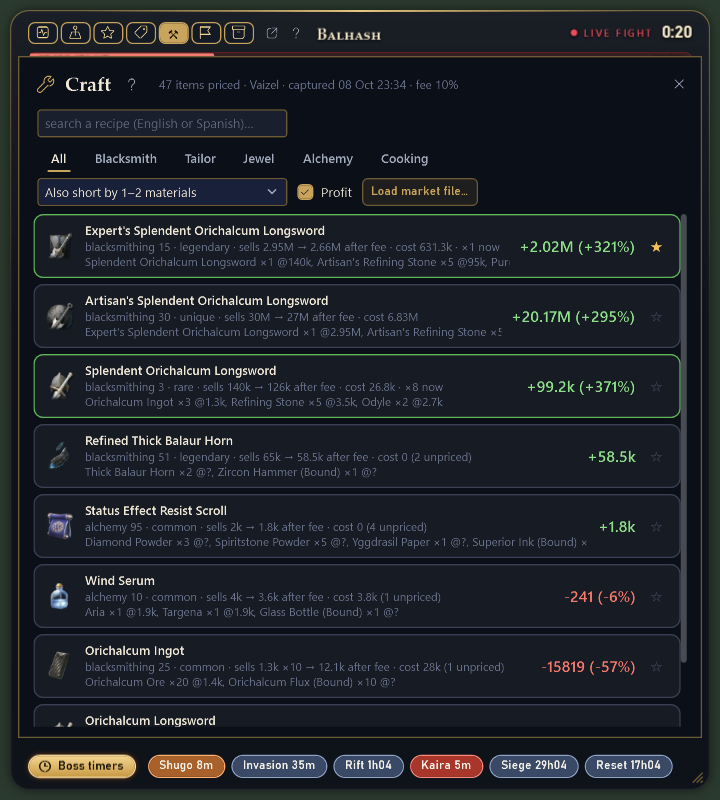<br><sub><b>Profit</b> — margin per recipe against the market export</sub></td>
  </tr>
</table>

- The recipes you can craft **now** with your bag and both warehouses, and *×N* how many times. *Also short by 1–2 materials* adds the ones you almost have, with what is missing and where it comes from (gathering, crafting, a dungeon drop with its chance, an NPC, an achievement).
- The search box looks through every recipe in English or Spanish; the **star** pins a recipe at the top of every list.
- **Profit**: *Load market file…* with the export from Prices, tick *Profit*, and every recipe whose result sells is listed by margin (cheapest listing × yield after the broker fee, minus the cheapest materials). A high margin with one or two listings may not sell.

### Build

<table>
  <tr>
    <td width="50%">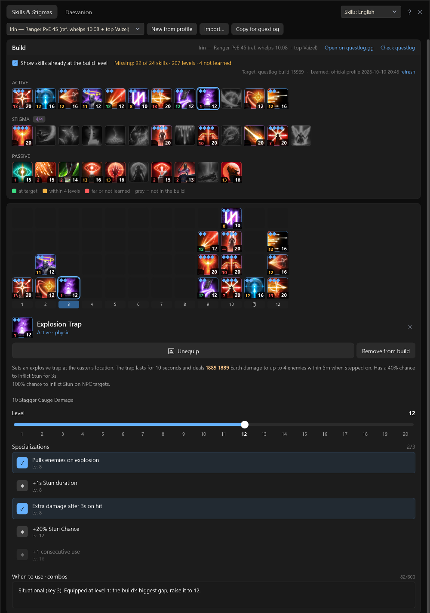<br><sub><b>Skills &amp; Stigmas</b> — target level bottom-right, yours bottom-left</sub></td>
    <td width="50%">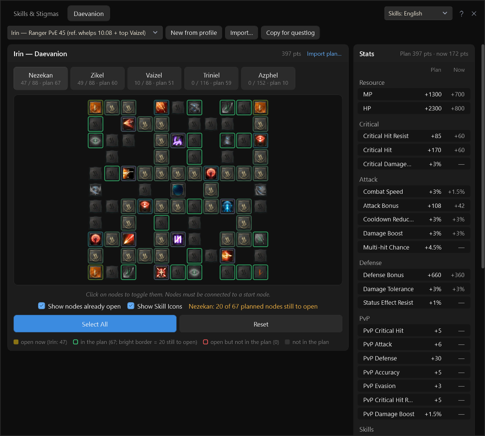<br><sub><b>Daevanion</b> — plan vs the nodes you have open, stats summed</sub></td>
  </tr>
  <tr>
    <td colspan="2">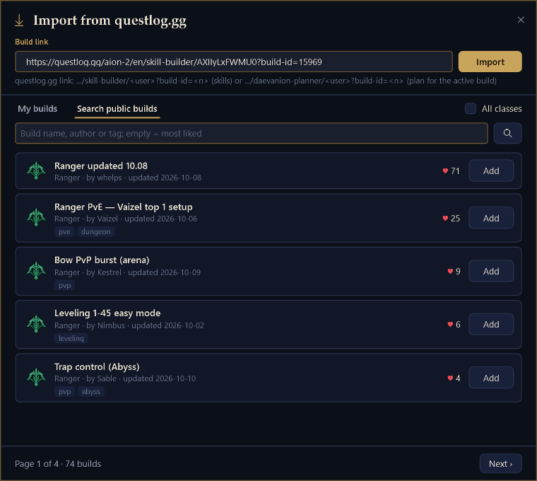<br><sub><b>Import</b> — paste a questlog.gg link, search public builds or list your own</sub></td>
  </tr>
</table>

- Your character's skill build in **questlog.gg's planner layout**, checked against its official profile: on every icon the bottom-right number is the build's level and the bottom-left one yours — green at target, amber within 4 levels, red further or not learned. Untick *Show skills already at the build level* to see only what is left.
- With no build yet, the tab offers the five most-liked public builds of your class: *Add* one, *Search…* for another, *Import…* a questlog link a friend sent you, or *New from profile* to start from what you have. Without logging in, *Import… → My builds* lists your own questlog builds and plans, and *Check questlog* offers *Update* when your questlog copy is newer.
- **Daevanion**: the five boards of your class; click nodes to plan, see which are already open, and compare the plan's stats with what you have now. *Import plan…* loads a questlog daevanion-planner plan.
- Click a skill for its level slider, specializations, your own note (*When to use · combos*) and the **relations** the meter works out by itself (which buff another skill gives it, which state it needs and who applies it, its key's chain, its place in your priority). Everything is saved on your PC, one file per build; *Copy for questlog* publishes it from your own browser session.

### Items

<p align="center">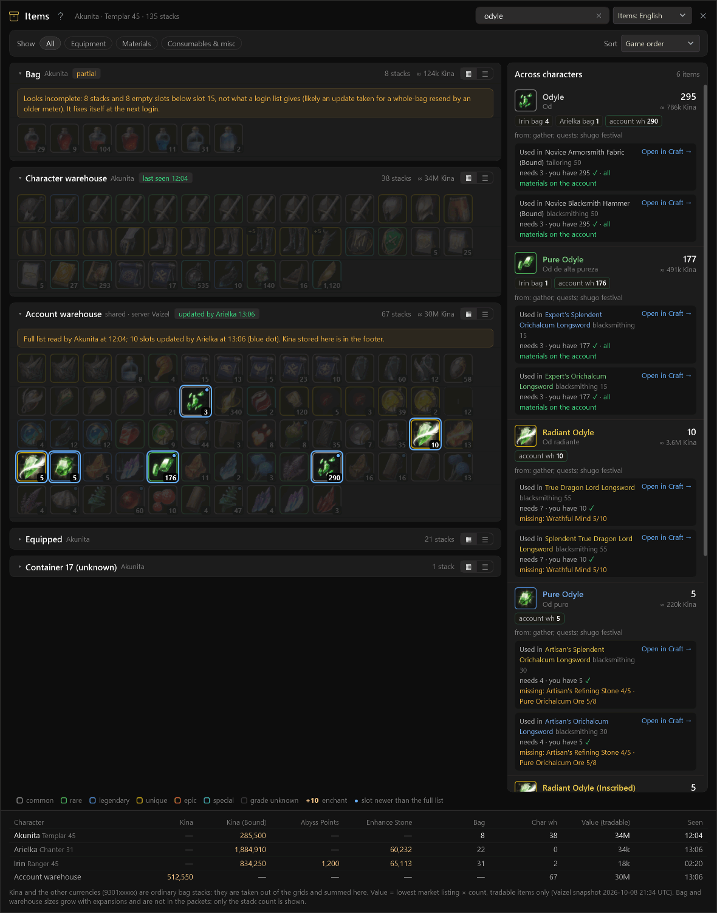</p>

- The **bag** and **character warehouse** of the character you play, the account's **shared warehouse** (the game's "server warehouse", merged slot by slot from what every character saw; a blue dot marks slots another character changed later) and the **equipped** set. Frame colour = grade; tiles or list view, filters and sort.
- **Search across characters** (English or Spanish): matching tiles light up and the side panel lists where each item is on every character, where it comes from and the recipes that use it, with *Open in Craft →*.
- The footer sums each character's Kina, bound Kina, Abyss Points, Enhance Stones and stock value. The game only sends a warehouse when its window opens: open each one once with the meter running.

### Character selector

<p align="center">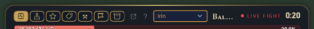</p>

The dropdown next to the tabs picks whose bag, warehouses, builds and craft counts the tabs show. It works while you play: the logged-in character is marked *(current)* and keeps receiving the live data, and the box turns amber while you are looking at someone else. Logging in with another character switches the view to it.

## Settings worth knowing

Settings is a tab like the others (with a pop-out button to open it in its own window).

- **Capture → Network adapter**: *Automatic* finds the adapter that carries the game connection (including ExitLag's loopback). Pick one by hand only if a VPN hides it. **Receive from another meter** takes a `host:port` instead, for a meter that does not see the game itself.
- **Hotkeys** (Windows): all editable, applied on save.
- **Game**: region and server (*Auto* from the login). **Start and stop with AION 2** (Windows) registers a task for your Windows user (no administrator) that starts the meter when the game runs and closes it a minute after the game ends. Untick to remove the task.
- **Updates** (Windows): the meter checks this repository shortly after start and every 2 hours. *Install updates by itself* downloads the new zip in the background, checks its size and SHA-256 against GitHub, and applies it at the next start or when you are not playing (after 10 minutes without a fight); the meter restarts by itself and your settings stay. Untick it to be asked instead. **Channel**: *Stable* (default) or *Development builds*.
- **Overlay**: bars relative to the top player or to the party, boss HP bar, GS / CP, show by itself and hide after N seconds, rows, opacity, row size.
- **Language**: the interface in English or Spanish, and the language of item, skill and monster names (follow the interface, or English / Spanish).

## Discontinued: server features

From this version on, **the meter sends nothing to the maintainer and there is no server behind it anymore**. The maintainer does not keep services running for the meter, so everything that needed one is gone from the code:

- **Anonymous usage statistics** — removed.
- **Uploading bug reports** ("Send to Diego") — removed. *Report a problem…* now only saves a zip on your PC: attach it to a [GitHub issue](https://github.com/akunito/aion2-meter-releases/issues) (see [Reporting a problem](#reporting-a-problem)).
- **The backup code and *Restore from code*** — removed. Old codes no longer restore anything: the server copy is deleted.
- **Sharing atlas node names** — removed. The names you give to nodes stay on your PC.

What to do instead: your builds, price watch list and favourite recipes are plain files in `%AppData%\AionMeter` (Linux: `~/.local/share/AionMeter`). To move to a new PC, copy that folder — `characters\<server>-<name>\builds\` holds the builds. Versions up to v0.5.0 still try to send; those sends simply fail without a word and nothing else breaks. Updating removes them.

## Reporting a problem

Right-click the gold **A** → *Report a problem…* (Linux: the card's *Settings*), describe what happened and save the zip. The zip holds the last two logs, crash files, your settings (without private addresses), the state summary, your Top DPS list and the build info; your inventory, titles and pets only if you tick the box. Then press *Open an issue on GitHub* (or go to [issues](https://github.com/akunito/aion2-meter-releases/issues)) and write what you did, what you expected and the zip attached. When the meter hits an error, a balloon opens the same window.

Packet recordings (*Settings → Capture → Record game packets*, off by default) contain your game traffic including character names: do not attach them to a public issue.

## Privacy

The meter reads the game's traffic on your PC and keeps everything in `%AppData%\AionMeter` (Linux: `~/.local/share/AionMeter`). It never sees your account or password, and **it sends nothing anywhere**: no statistics, no fights, no reports.

What it fetches (read-only):

- **aion2.plaync.com** — your character's public official profile (skills, Daevanion, gear) at login and every 6 hours; the profiles you open in Top DPS and in the player card.
- **questlog.gg** — public builds for the Build tab (suggestions, search, imports, your own builds).
- **aion2.exchange** — once an hour, only the items you watch in Prices.
- **aion2index.com** — the Server / Europe rankings, only when you open them.
- **aion2hub.me** — item icons and names it does not ship with, on demand.
- **assets.playnccdn.com** and **metabot.gg** — skill icons and boss portraits, once each (can be turned off in Settings).
- **github.com** — the update check and the update download from this repository (Windows).

## Linux

The Linux version is the same meter in two pieces:

- **The capture daemon** (`aionmeter-daemon`) — the meter without a window: capture, combat engine, history, inventory, timers, prices. It runs as a **systemd system service under your own user**, with only `CAP_NET_RAW` and `CAP_NET_ADMIN` (what libpcap needs to capture). It runs as the same user as the game, so it can find the game's connection without any other privilege. It is **not** started at boot: the `aionmeter` launcher starts it when the card opens and stops it when the card closes.
- **The card** (`aionmeter`) — a native **GTK 4 Wayland** window with every tab: meter, atlas, top DPS, prices, craft, build, items, boss timers, settings, help, the player card and *Report a problem*.

Data lives in `~/.local/share/AionMeter`, with the same files and format as `%AppData%\AionMeter` on Windows: you can copy a Windows data folder over and keep your fights, builds and watch list.

### Requirements

- Linux x86_64 with **systemd** and **polkit**, in a **Wayland** session (the card is a Wayland client; X11 / Xwayland is not supported).
- **.NET 10 runtime**, **libpcap**, **GTK 4**. Optional: **gtk4-layer-shell** (only for `--layer`) and **webp-pixbuf-loader** (questlog's skill icons are WebP).
- AION 2 through Steam / Proton, running as the same user that installs the meter.

Install the packages with your distribution's package manager:

| Distribution | Command |
|---|---|
| Arch / CachyOS / EndeavourOS | `sudo pacman -S dotnet-runtime libpcap gtk4 gtk4-layer-shell webp-pixbuf-loader` |
| Fedora 43 | `sudo dnf install dotnet-runtime-10.0 libpcap gtk4 gtk4-layer-shell webp-pixbuf-loader` |
| Ubuntu 25.10+ | `sudo apt install dotnet-runtime-10.0 libpcap0.8t64 libgtk-4-1 libgtk4-layer-shell0 webp-pixbuf-loader` |
| Debian 13 | `sudo apt install libpcap0.8t64 libgtk-4-1 libgtk4-layer-shell0 webp-pixbuf-loader`, plus .NET as below |
| .NET where the distribution has none | [Microsoft's instructions](https://learn.microsoft.com/dotnet/core/install/linux), or `dotnet-install.sh --runtime dotnet --channel 10.0` (into `~/.dotnet`, which the installer and the launcher also find) |

`install.sh` checks for them and prints this list if something is missing.

### Installation

```sh
tar xzf AION2DpsMeter-v<version>-linux-x64.tar.gz
cd AION2DpsMeter-linux
./install.sh
```

Run it as yourself, not as root: it asks for `sudo` once, to write the systemd unit (`/etc/systemd/system/aion2-meter-daemon.service`) and a polkit rule (`/etc/polkit-1/rules.d/50-aion2-meter.rules`) that lets your user start and stop that one unit without a password. Everything else goes into your home:

- the program in `~/.local/opt/aionmeter` (the previous version is kept in `~/.local/opt/aionmeter.prev`),
- the commands `aionmeter`, `aionmeter-toggle` and `aionmeter-clicks` in `~/.local/bin`,
- an *AION 2 DPS Meter* entry in your app menu,
- the launcher settings in `~/.config/aionmeter/launcher.conf`.

| Option | |
|---|---|
| `--layer` | the card is a layer-shell overlay instead of a window (see [Compositors](#compositors-and-fullscreen)) |
| `--monitor NAME` | output for the `--layer` card, e.g. `DP-1` (default: the compositor's choice) |
| `--prefix DIR` | install the program somewhere else than `~/.local/opt/aionmeter` |
| `--no-system` | skip the root part (unit + polkit rule), e.g. on NixOS where the module provides it |

### First start

Run `aionmeter` (or pick *AION 2 DPS Meter* in your app menu). The card opens and starts the daemon; the status line at the bottom of the card says *"Waiting for the game to connect…"* until the game runs, then *"Capturing · …"*. As on Windows, **start the meter before you log in with your character**: player names arrive on loading screens, and your pets, inventory and titles arrive at login.

Closing the card (or `aionmeter --quit`) stops the daemon; the fight in progress is saved first. *Settings → Daemon* on the card restarts the daemon or quits the card.

### Commands

| | |
|---|---|
| `aionmeter` / `aionmeter --show` | start the card, or show and raise the running one |
| `aionmeter --tab KEY` | open a tab: `meter`, `atlas`, `top`, `prices`, `craft`, `build`, `items`, `timers`, `settings` |
| `aionmeter --hide` / `--toggle` / `--quit` | hide, hide/show, close the card (and stop the daemon) |
| `aionmeter-toggle` | hide/show the card, or start it if it is not running — bind it to a key |
| `aionmeter-clicks` | click-through on/off: clicks go to the game — bind it to a key |
| drag the card | move it (its header on every tab, or any part that is not a control), also onto another output |
| right-button drag, or the gold bottom-right corner | resize from the nearest edge or corner |
| mouse wheel over the resize corner | zoom the card |

A second `aionmeter` call hands its command to the running card and exits, so key bindings can call it freely. Example key bindings for Sway (`~/.config/sway/config`):

```
bindsym $mod+g exec aionmeter-toggle
bindsym $mod+Shift+g exec aionmeter-clicks
```

### Compositors and fullscreen

- **Window mode** (the default) works on any Wayland compositor. The card is a normal window with app id `aionmeter`. On **Sway** it also remembers its position and size (through Sway IPC); on other compositors the compositor places it.
- A normal window is **hidden behind a fullscreen game**. Either play in a borderless window / windowed mode and keep the card floating on top, or install with **`--layer`**: the card becomes a layer-shell surface on the overlay layer, above fullscreen windows, placed by the card itself. `--layer` needs gtk4-layer-shell and a compositor with the wlr-layer-shell protocol — wlroots compositors such as Sway, Hyprland or river, and KDE Plasma. GNOME does not support it.

Sway rules for the window mode (`~/.config/sway/config`):

```
for_window [app_id="aionmeter"] floating enable, sticky enable, border none
no_focus [app_id="aionmeter"]
```

### NixOS

The tarball (and this repository) carries a NixOS module, `linux/nixos/aion2-meter.nix`, which provides with Nix store paths what `install.sh` writes as root: the capture unit, the polkit rule and the three launchers (with .NET, libpcap, GTK 4, gtk4-layer-shell and the WebP loader on their paths).

```nix
imports = [ ./aion2-meter.nix ];
programs.aion2-meter = {
  enable = true;
  user = "alice";          # the user who plays
  # layer = true; monitor = "DP-1";      # layer-shell card
  # forward = "127.0.0.1:47013";         # also stream packets to a Windows meter under Wine / in a VM
  # prefix = null; dataDir = null;       # defaults: ~/.local/opt/aionmeter, ~/.local/share/AionMeter
};
```

Rebuild, then unpack the tarball and run `./install.sh --no-system` to put the program in `~/.local/opt/aionmeter`. Updates need no change to the configuration: unpack the new tarball and run `./install.sh --no-system` again.

### Updating, uninstalling, logs

- **Updating**: there is no self-update on Linux. Download the new tarball and run `./install.sh` again: it swaps the program (the old one stays in `~/.local/opt/aionmeter.prev`), restarts the daemon if it was running, and keeps your data and launcher settings.
- **Uninstalling**: `./uninstall.sh` removes the program, the commands, the menu entry, the unit and the polkit rule, and keeps `~/.local/share/AionMeter`; `./uninstall.sh --purge` deletes the data too.
- **Logs**: `journalctl -u aion2-meter-daemon -f` for the daemon; the meter's own logs are in `~/.local/share/AionMeter/logs/`.

### What is Windows-only

The tray icon, Windows notifications, *Start and stop with AION 2*, the self-update and the global hotkeys. On Linux the card holds what the tray menu does on Windows, and the hotkeys are your compositor's key bindings ([Commands](#commands)).

### Linux FAQ

**The status says "No capture (libpcap missing …)".**
Install libpcap (table above). On NixOS use the module: `${pkgs.libpcap}/lib` alone holds no library.

**It stays on "Waiting for the game to connect…".**
The game must run as the same user as the meter. If the game runs in its own process namespace, the daemon falls back to the connections to the game's port after 30 s; with two network adapters carrying it, pick yours in *Settings → Capture*.

**The card does not show over the game.**
The game is fullscreen: play borderless/windowed, or reinstall with `./install.sh --layer` (see [Compositors](#compositors-and-fullscreen)).

**`aionmeter` says it could not start `aion2-meter-daemon.service`.**
The polkit rule is missing (installed with `--no-system`, or polkit is not running): run `./install.sh` again without `--no-system`, or start it by hand with `sudo systemctl start aion2-meter-daemon`.

## FAQ

**The overlay is empty / I see no DPS.**
Check that Npcap is installed (step 1) — without it everything but the live DPS works, and the status line says so; once Npcap is in, the capture starts by itself. Hover the gold **A**: if it says *"No Npcap adapter carries the game connection"*, pick your adapter in *Settings → Capture*. The overlay hides outside combat: <kbd>Ctrl</kbd>+<kbd>Shift</kbd>+<kbd>D</kbd> shows it. Exclusive full screen covers it: play in borderless window or put the meter on another monitor.

**Players show as "Templar #12345".**
Names arrive on loading screens. Enter a dungeon or pass a loading screen and they appear; next time start the meter before logging in.

**Does it work with ExitLag or a VPN?**
Yes with ExitLag and other ping boosters (Npcap's default options capture their loopback). If a VPN hides the game connection, choose the adapter in *Settings → Capture*.

**Item icons are missing.**
The archive ships no item pictures (there are over 12,000): each icon is downloaded the first time a row needs it and cached, so they fill in over a few seconds. A few icons are WebP and only show if Windows has the WebP codec (Linux: webp-pixbuf-loader). Skill icons and boss portraits work the same way, and *Settings → Download skill icons and boss portraits* turns all of it off.

**How do I bring a questlog.gg build in?**
Build tab → *Import…* → paste the link (`…/skill-builder/<user>?build-id=<n>`, or a `daevanion-planner` link for a plan) → *Import*. Or search the public builds, or open *My builds* to list your own questlog builds without logging in. Importing the same build again refreshes it and keeps your notes and plan.

**I have a new PC. How do I get my builds back?**
Copy the data folder (`%AppData%\AionMeter`, Linux `~/.local/share/AionMeter`) from the old PC. The backup code is gone: see [Discontinued: server features](#discontinued-server-features).

**Windows or my antivirus complains.**
The build is not signed with a paid certificate and it reads network traffic, which some antiviruses dislike. Allow it (Windows Security → Virus & threat protection → Protection history → Allow) or exclude the meter's folder. You can check the zip against `SHA256SUMS.txt`, or build it yourself from this source.

**I got a "new version" message.**
Normal: the meter updates itself from this repository and restarts on its own; your settings and history stay.

**My crit rate on a crowded field boss is almost zero / most players are missing on a world boss.**
On busy bosses the game stops sending most of the damage (and many crits) to your client. The meter shows exactly what arrives and says *"N attacking · damage of M sent"* instead of a party DPS it cannot know.

**Can I get banned?**
The meter does not touch the game: no memory reading, no injection, nothing sent to it. Third-party tools may still be against the terms of service — your call.

## Building from source

Docker is the only thing needed on the host; the build runs in `mcr.microsoft.com/dotnet/sdk:10.0`.

```sh
build/build.sh                  # tests + Windows zip + Linux tarball
build/build.sh --linux-only     # tests + Linux tarball (skips the slow win-x64 single-file publish)
build/build.sh --no-tests       # skip the test suite (local iteration only; releases always run it)
VERSION=0.6.0 build/build.sh    # a release build: version in the assemblies, "release v0.6.0" in BUILD-INFO
tools/release.sh 0.6.0 NOTES.md    # maintainer: build with tests + publish the GitHub release (--dev = pre-release)
```

The archives and `SHA256SUMS.txt` land in `dist/`. Builds without `VERSION` are development builds and never update themselves.

Repository layout:

| | |
|---|---|
| `src/AionMeter.Core` | capture, protocol decoding, combat engine, game data, market, atlas (upstream's core lives here) |
| `src/AionMeter.Service` | the engine shared by every front-end: settings, history, inventory, timers, prices, builds |
| `src/AionMeter.App` | the Windows app (WPF) |
| `src/AionMeter.Daemon` | the Linux capture daemon |
| `src/AionMeter.Overlay` | the Linux card (GTK 4) |
| `src/AionMeter.Cli` | command-line tool (live capture, replay of recordings) |
| `tests/` | the test suite |
| `data/` | game data, atlas maps, help pages shipped with the meter |
| `linux/` | `install.sh`, launchers, systemd unit, polkit rule, NixOS module |
| `build/` | `build.sh` |

Contributions are welcome: issues and pull requests here. Fixes to the capture, the protocol or the combat engine belong upstream too — please also send them to [cyberbadger6969/aion2-dps-meter](https://github.com/cyberbadger6969/aion2-dps-meter), whose core this fork follows.

## Credits and licence

- **[cyberbadger6969/aion2-dps-meter](https://github.com/cyberbadger6969/aion2-dps-meter)** — the meter this fork is based on, and its core: capture, protocol, combat engine, overlay, breakdown, history and boss timers. GPL-3.0. See [its README](https://github.com/cyberbadger6969/aion2-dps-meter#readme). Its game data tables come from the GPL-3.0 projects [A2Tools-DPS-Meter](https://github.com/taengu/A2Tools-DPS-Meter) (taengu) and [AIon2-Dps-Meter](https://github.com/Kuroukihime/AIon2-Dps-Meter) (Kuroukihime).
- **[questlog.gg](https://questlog.gg)** — the skill database and the public builds and planners the Build tab reads and imports.
- **[aion2hub.me](https://aion2hub.me)** — item names, recipes, item sources, pets and titles, and the item icons.
- **[aion2.exchange](https://aion2.exchange)** — market prices for Prices and the Craft profit calculator.
- **[shugo.gg](https://shugo.gg)** — the event timers and the map tiles and node positions behind the Atlas.
- **[aion2index.com](https://aion2index.com)** — the combat-power rankings in Top DPS.
- Skill icons from the official AION 2 CDN, character profiles from the official AION 2 site, boss portraits from [MetaBot.GG](https://metabot.gg).

This fork is distributed under the **GPL-3.0**, the upstream licence; the full text is [`LICENSE`](LICENSE). AION 2 and its game data and art are © NCSOFT; this project is not affiliated with NCSOFT or with the upstream author.
